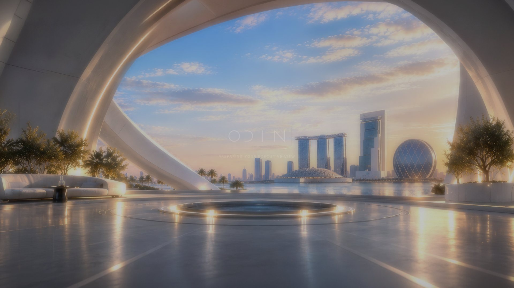
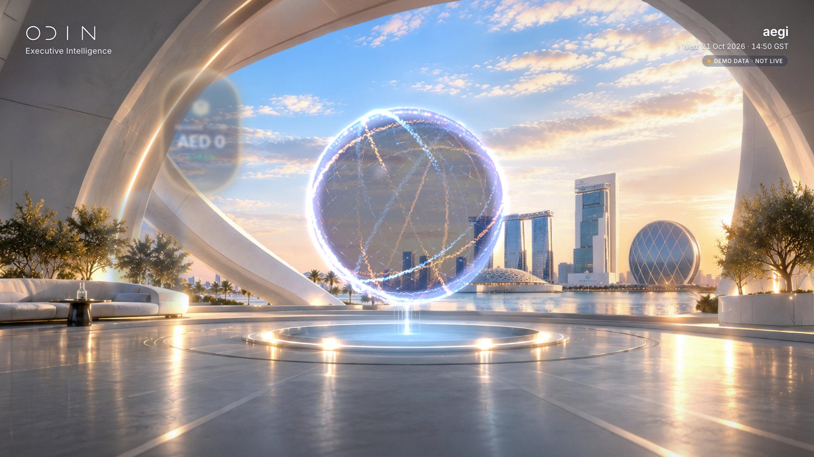
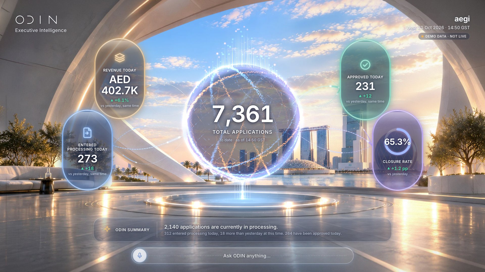
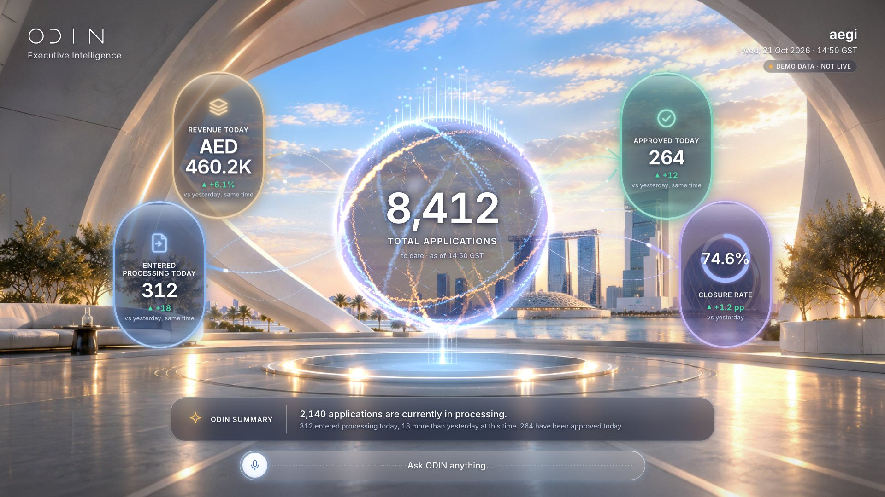

# S01 · Intro load-in

> ODIN appears: room, globe and capsules assemble with the intro pulse.

| | |
|---|---|
| Type | System state |
| Feature | — |
| Scope status | **System** · System state. |
| Effects | [E00](../../03-effects/E00-canvas-layer/SPEC.md) · [E03](../../03-effects/E03-globe-aura/SPEC.md) · [E06](../../03-effects/E06-environment/SPEC.md) · [E07](../../03-effects/E07-post-fx/SPEC.md) · [E09](../../03-effects/E09-sound/SPEC.md) · [E10](../../03-effects/E10-intro/SPEC.md) |

## Captures

## Files

`component/` holds this screen's own source (same paths as the reference app):

- `src/ui/IntroDirector.tsx`
- `src/ui/intro.css`
- `src/lib/intro.ts`
