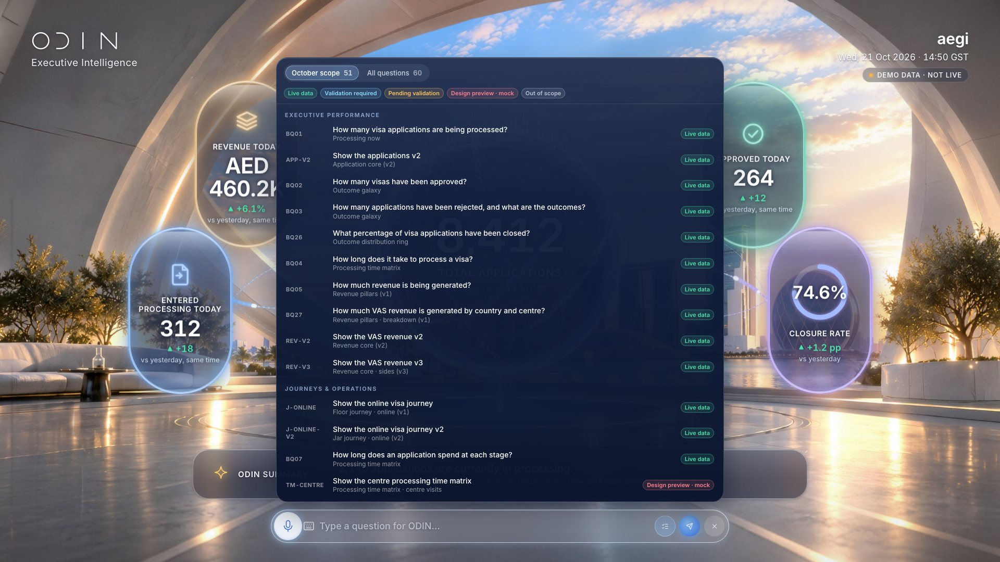

# S02 · Question composer

> Typed question or pick from the catalogue (required / all scope).

| | |
|---|---|
| Type | System state |
| Feature | — |
| Scope status | **System** · System state. |
| Effects | — |

## Captures

## Files

`component/` holds this screen's own source (same paths as the reference app):

- `src/ui/hud/MicBar.tsx`
- `src/ui/hud/QuestionPicker.tsx`
- `src/ui/hud/hud.css`
- `src/odin/questions.ts`
