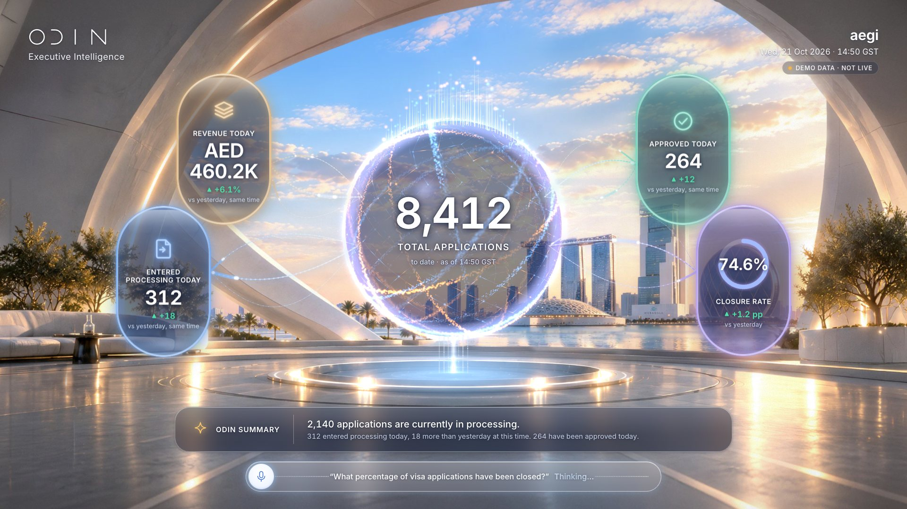

# S03 · Thinking

> The heard question is echoed while ODIN resolves the answer.

| | |
|---|---|
| Type | System state |
| Feature | — |
| Scope status | **System** · System state. |
| Effects | — |

## Captures

## Files

`component/` holds this screen's own source (same paths as the reference app):

- `src/ui/hud/MicBar.tsx`
- `src/ui/hud/hud.css`
