# S04 · Morph transition

> Any screen to any screen: six choreographies, particles through ODIN, morph sound.

| | |
|---|---|
| Type | System state |
| Feature | — |
| Scope status | **System** · System state. |
| Effects | [E00](../../03-effects/E00-canvas-layer/SPEC.md) · [E01](../../03-effects/E01-morph/SPEC.md) · [E02](../../03-effects/E02-particles/SPEC.md) · [E03](../../03-effects/E03-globe-aura/SPEC.md) · [E09](../../03-effects/E09-sound/SPEC.md) |

## Captures

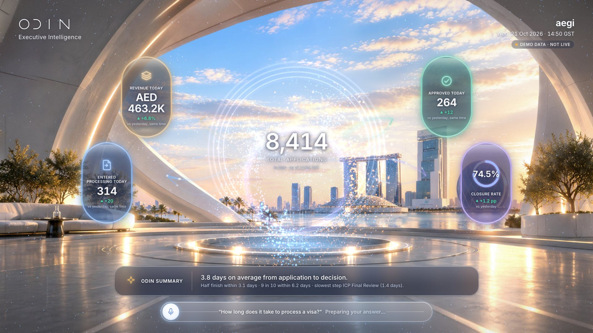
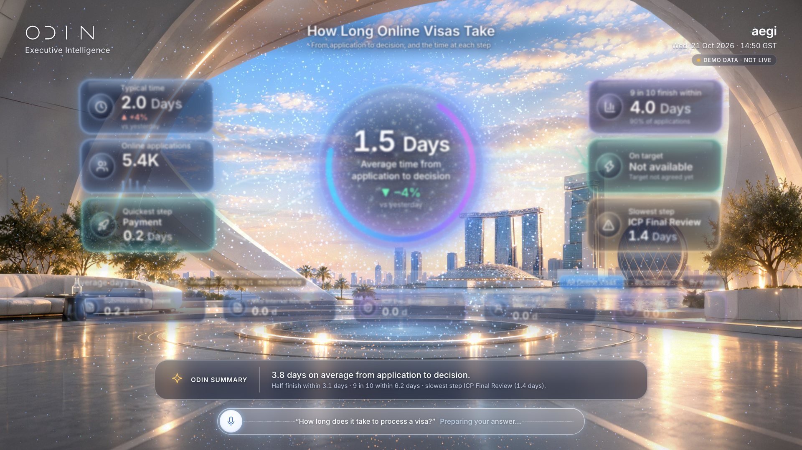
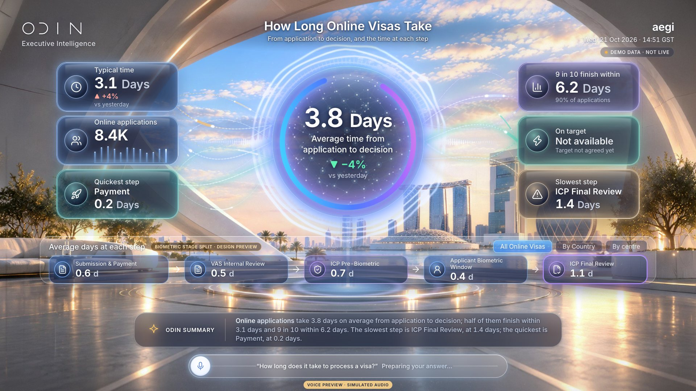

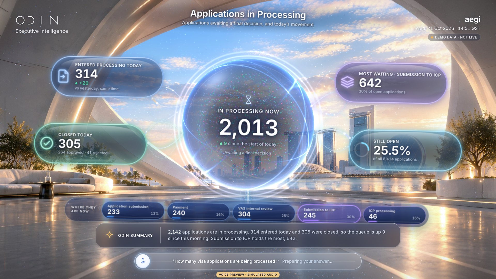
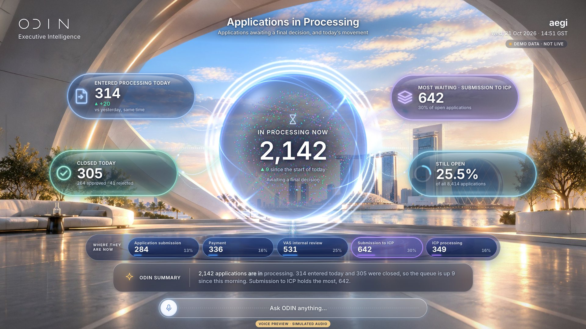
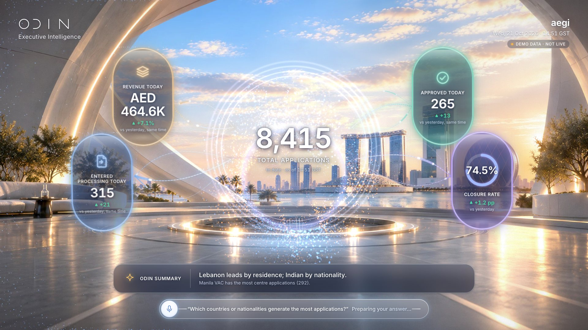
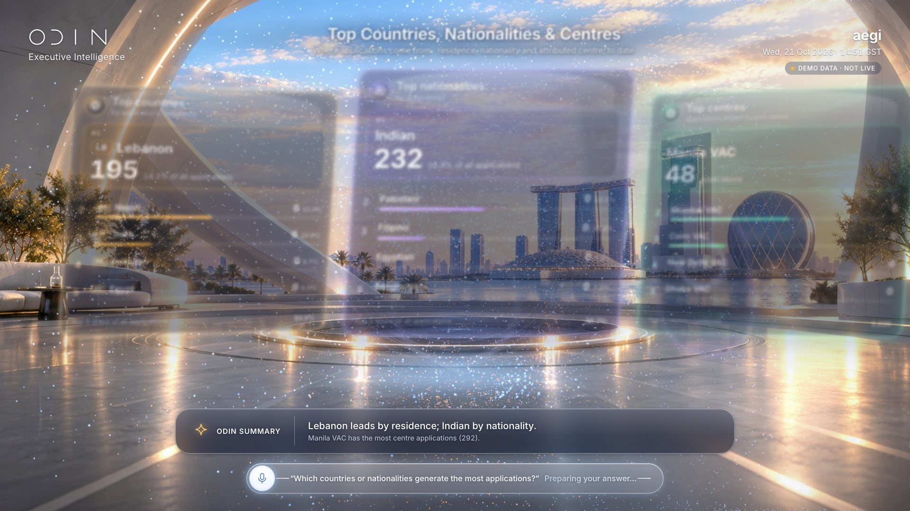
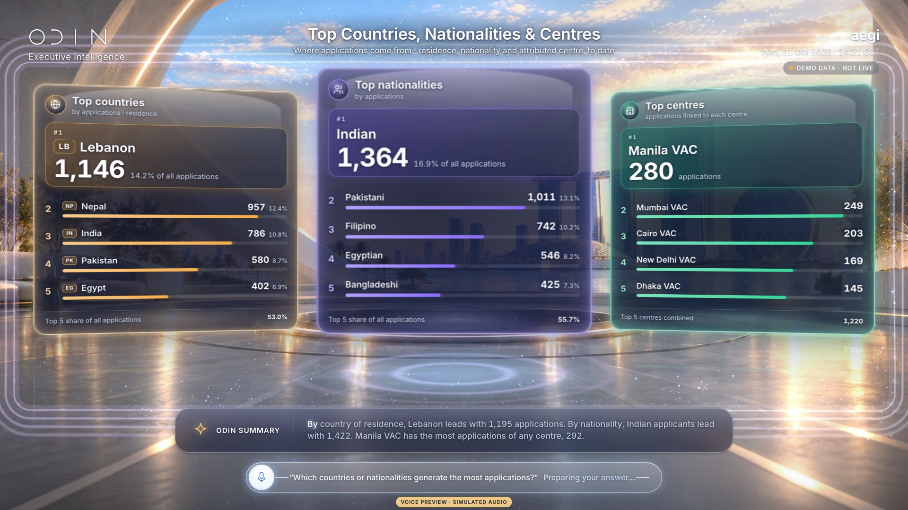

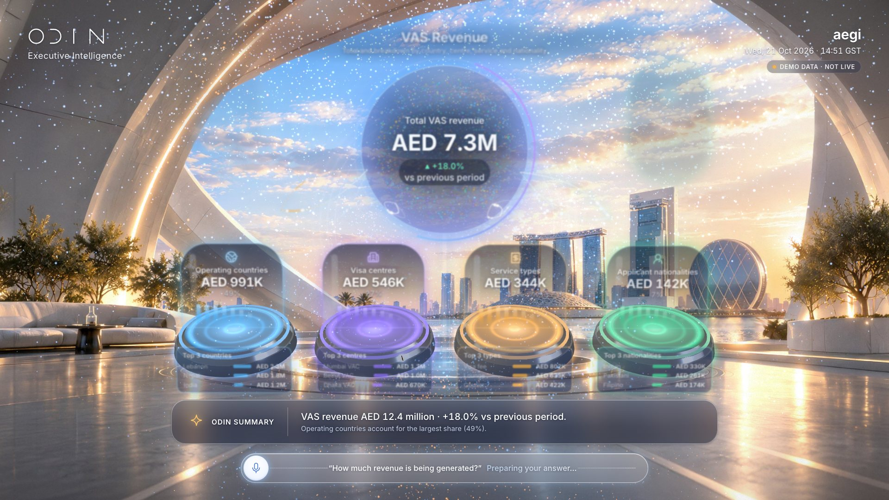
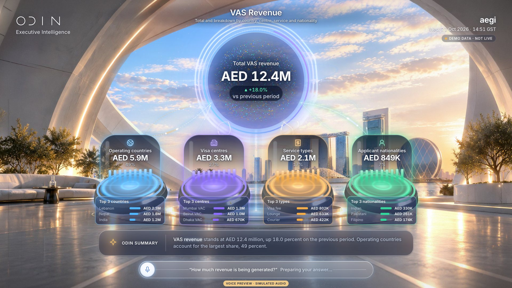

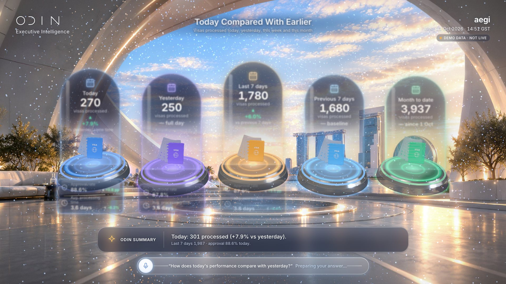
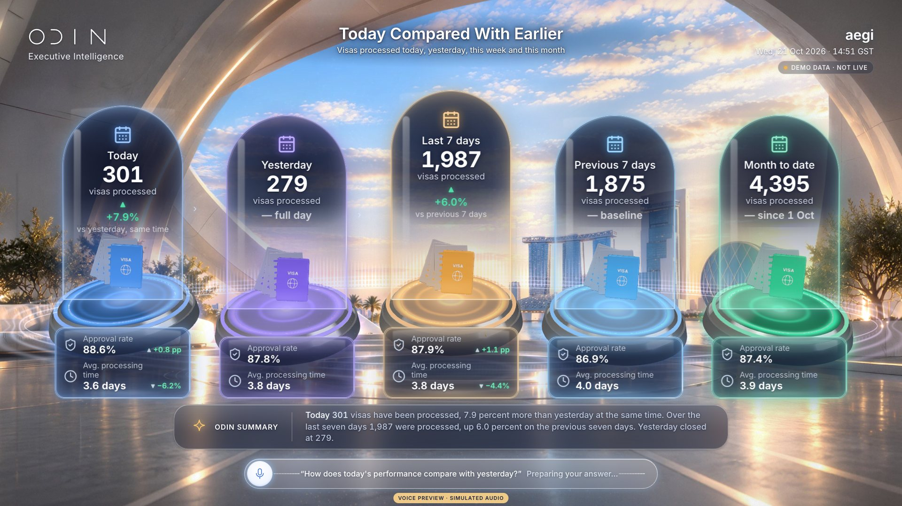
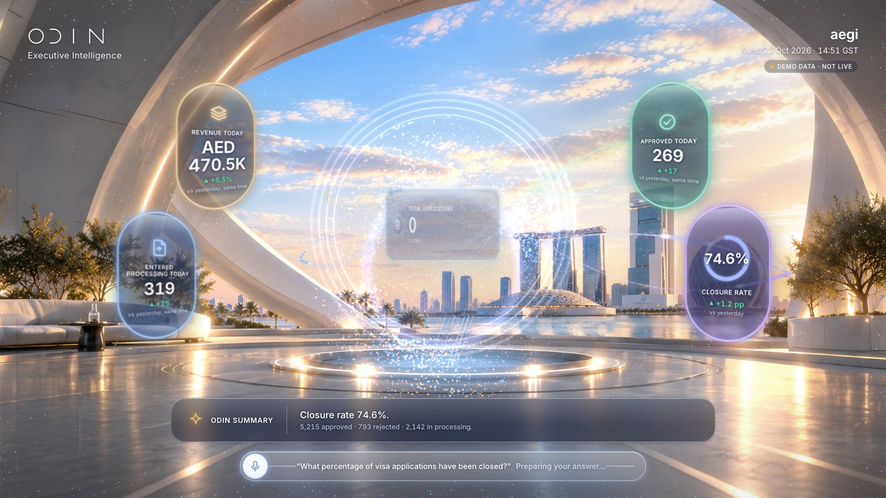
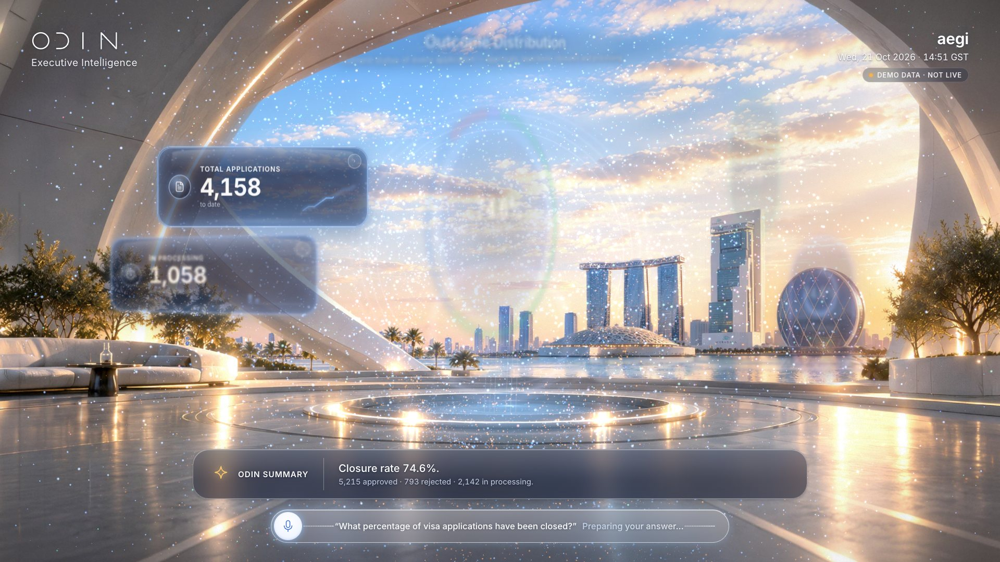
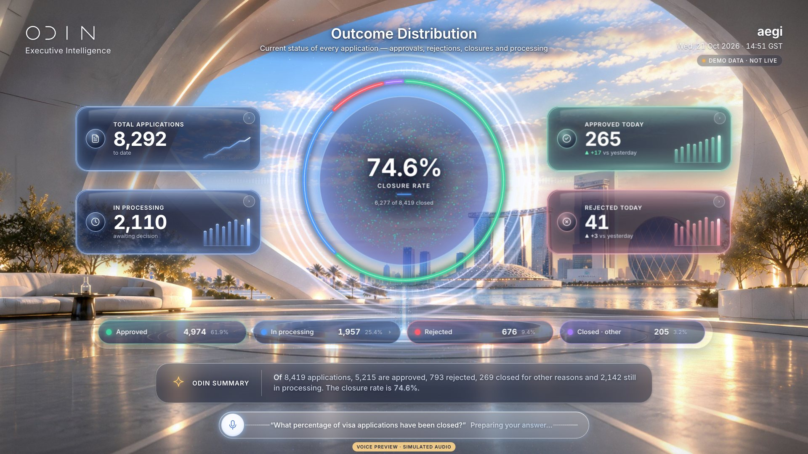

## Files

`component/` holds this screen's own source (same paths as the reference app):

- `src/odin/director.ts`
- `src/odin/fx.ts`
- `src/scene/TransitionParticles.tsx`
