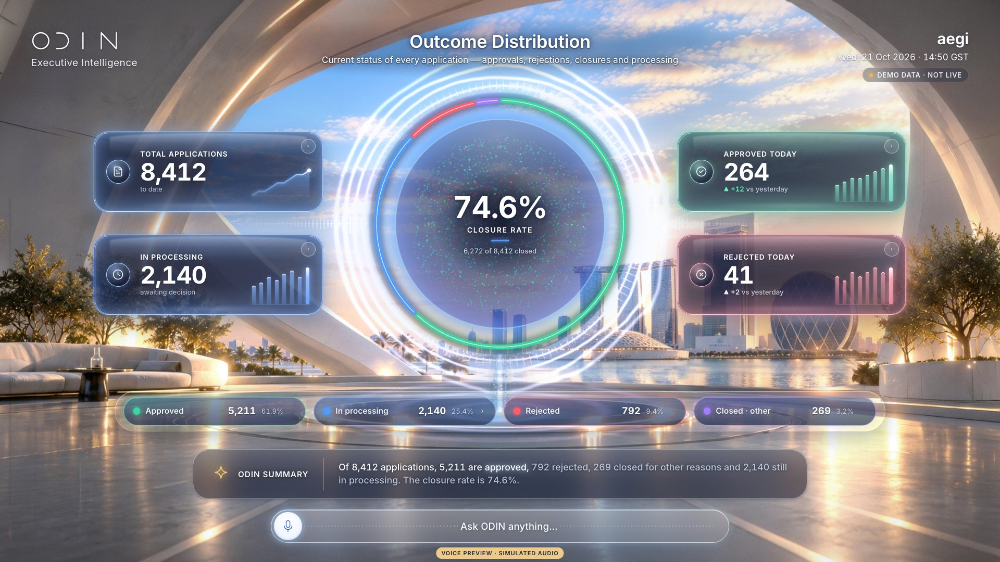

# S05 · Speaking + summary

> ODIN speaks; the spectrum wraps the focus object and the summary strip captions it.

| | |
|---|---|
| Type | System state |
| Feature | — |
| Scope status | **System** · System state. |
| Effects | [E00](../../03-effects/E00-canvas-layer/SPEC.md) · [E03](../../03-effects/E03-globe-aura/SPEC.md) · [E09](../../03-effects/E09-sound/SPEC.md) |

## Captures

## Files

`component/` holds this screen's own source (same paths as the reference app):

- `src/ui/hud/InsightStrip.tsx`
- `src/ui/hud/hud.css`
- `src/state/caption.ts`
- `src/scene/SpectrumAura.tsx`
