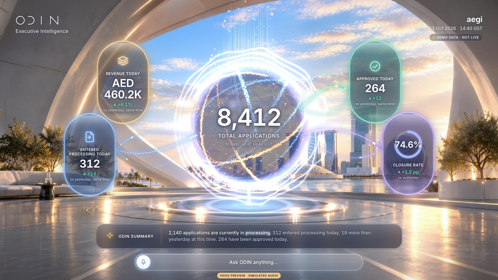
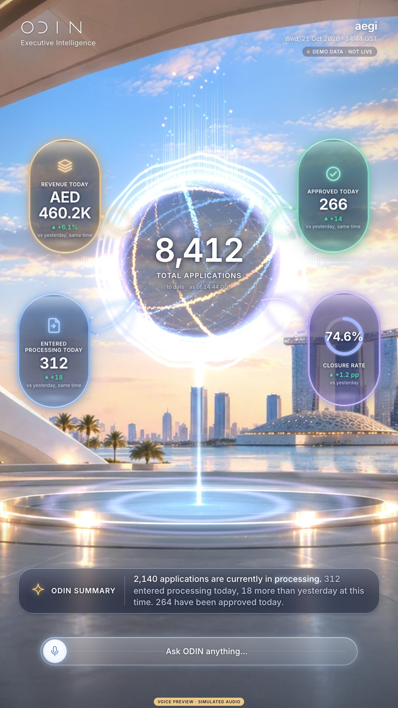
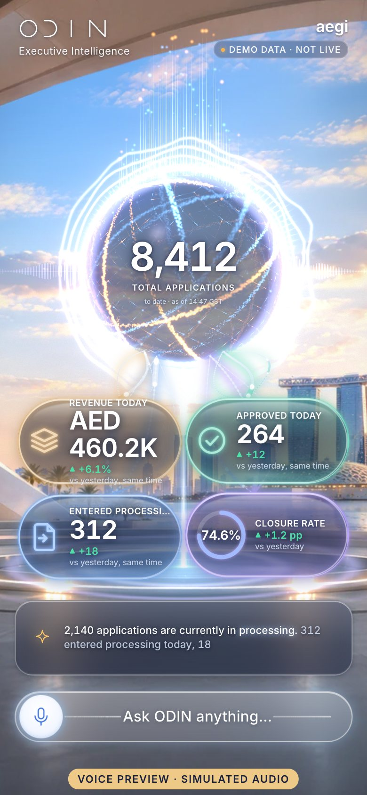

# V01 · Executive Home

> Total applications in the globe with four live KPI capsules.

| | |
|---|---|
| Type | Screen |
| Feature | Home |
| Scope status | **Green** · In October scope. |
| Effects | [E00](../../03-effects/E00-canvas-layer/SPEC.md) · [E03](../../03-effects/E03-globe-aura/SPEC.md) · [E05](../../03-effects/E05-energy-streams/SPEC.md) · [E06](../../03-effects/E06-environment/SPEC.md) · [E07](../../03-effects/E07-post-fx/SPEC.md) · [E08](../../03-effects/E08-count-up/SPEC.md) · [E10](../../03-effects/E10-intro/SPEC.md) |
| Preview (reference app) | `http://localhost:5173/?view=V01` |

**Notes.** Card A (capsule). Data via HomeComposition props (HomeData).

## Captures

## Files

`component/` holds this screen's own source (same paths as the reference app):

- `src/ui/home/HomeComposition.tsx`
- `src/ui/home/KpiCapsule.tsx`
- `src/ui/home/EnergyStreams.tsx`
- `src/ui/home/home.css`
- `src/ui/NumberRoll.tsx`
- `src/ui/icons.tsx`
- `src/lib/layout.ts`

## Data contract

Home takes `HomeData` as props (`HomeComposition({ data, current, visible })`): `total` (Kpi), `orbs` (four Kpi: VAS revenue, entered processing today, approved today, closure rate), `asOf`. Schema: `05-data-contracts/home-data.schema.json`.

## Morph keys

Keep these `data-morph` keys so shared elements travel between screens (E01): `home-energy`, `total-applications`, `home:vas-revenue`, `home:entered-today`, `home:approved-today`, `home:closure-rate`

## Port it

See `06-port-kit/PORT-PROMPTS.md` → V01. Done = contract test + acceptance test (`ODIN_VIEWS=V01`) pass, motion reviewed.
