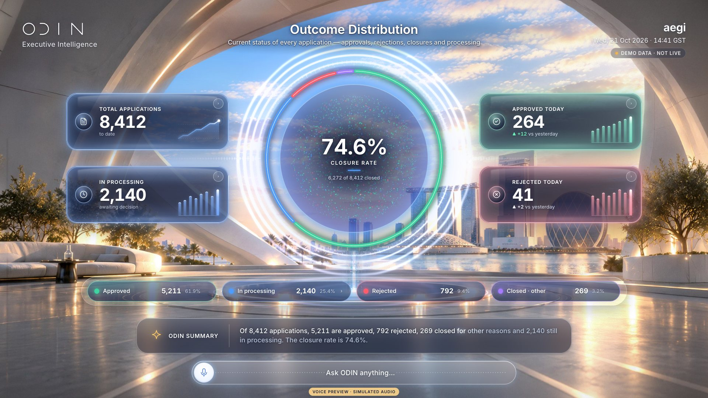
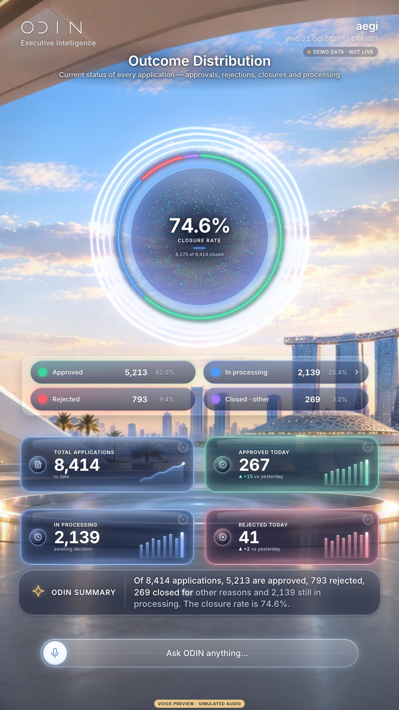
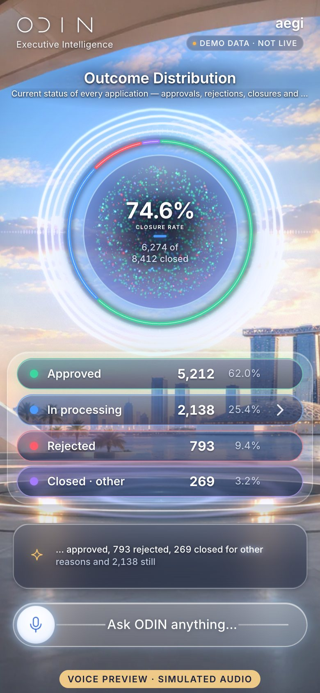

# V04 · Outcome Distribution

> Closure rate with the full status split and four headline cards.

| | |
|---|---|
| Type | Screen |
| Opens with | “What percentage of visa applications have been closed?” |
| Business questions | BQ26 |
| Feature | F06 |
| Scope status | **Green** · In October scope. |
| Template | `ringCards` |
| Components | `donut`, `legend`, `metric` |
| 3D objects (E04) | donut |
| Effects | [E00](../../03-effects/E00-canvas-layer/SPEC.md) · [E01](../../03-effects/E01-morph/SPEC.md) · [E02](../../03-effects/E02-particles/SPEC.md) · [E03](../../03-effects/E03-globe-aura/SPEC.md) · [E04](../../03-effects/E04-3d-objects/SPEC.md) · [E06](../../03-effects/E06-environment/SPEC.md) · [E07](../../03-effects/E07-post-fx/SPEC.md) · [E08](../../03-effects/E08-count-up/SPEC.md) · [E09](../../03-effects/E09-sound/SPEC.md) · [E11](../../03-effects/E11-composer/SPEC.md) |
| Preview (reference app) | `http://localhost:5173/?view=V04` |

**Notes.** Card C (hero glass) headline cards.

## Captures

## Files

`component/` holds this screen's own source (same paths as the reference app):

- `src/ui/scene/components/Donut.tsx`
- `src/ui/scene/components/donutGeometry.ts`
- `src/ui/scene/components/Panels.tsx`
- `src/ui/scene/HeroGlass.tsx`
- `src/ui/scene/hero-glass.css`

**Shared** (port once, used by many screens): `src/ui/scene/components/shared.tsx`, `src/ui/scene/SceneIcon.tsx`, `src/ui/bridge.tsx`, `src/lib/format.ts`, `src/lib/homeLayout.ts`, plus the design-system CSS in `02-design-system/source`.

## Data contract

`spec.sample.json` is exactly what this screen renders (DEMO DATA). Types: `05-data-contracts/source/src/odin/types.ts` (`SceneAnswer`). Fields per component:

- `donut` · key `ring`: `total`, `totalLabel`, `basis`, `segments`, `clean`, `centre`
- `legend` · key `legend`: `items`
- `metric` · key `total-applications`: `tile`, `card`, `label`, `value`, `format`, `icon`, `accent`, `caption`, `spark`, `ask`
- `metric` · key `in-proc`: `tile`, `card`, `label`, `value`, `format`, `icon`, `accent`, `caption`, `spark`, `ask`
- `metric` · key `approved-today`: `tile`, `card`, `label`, `value`, `format`, `icon`, `accent`, `delta`, `spark`, `ask`
- `metric` · key `rejected-today`: `tile`, `card`, `label`, `value`, `format`, `icon`, `accent`, `delta`, `spark`, `ask`

## Morph keys

Keep these `data-morph` keys so shared elements travel between screens (E01): `ring`, `legend`, `total-applications`, `in-proc`, `approved-today`, `rejected-today`

## Port it

See `06-port-kit/PORT-PROMPTS.md` → V04. Done = contract test + acceptance test (`ODIN_VIEWS=V04`) pass, motion reviewed.
