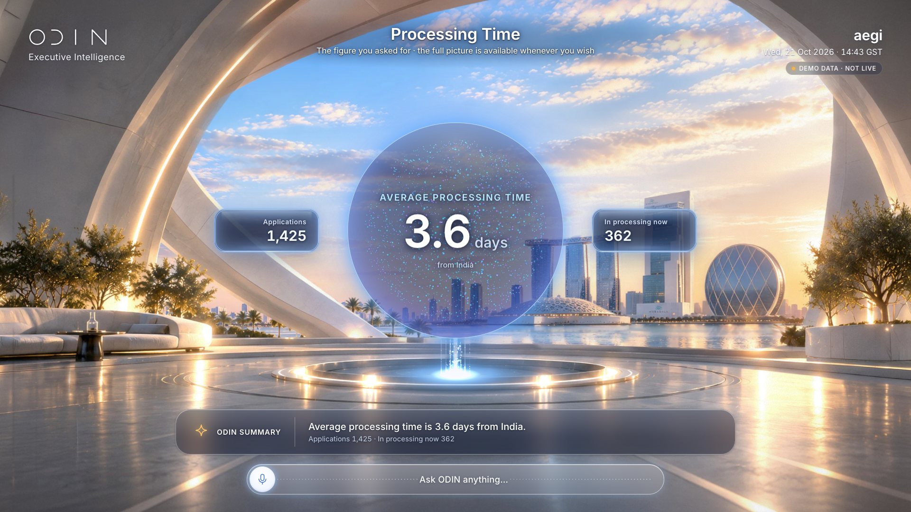
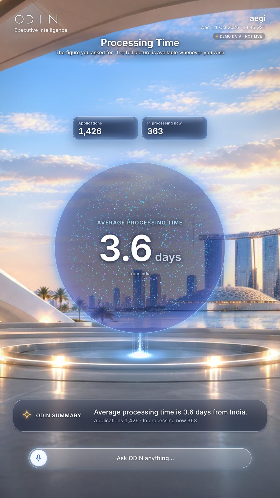
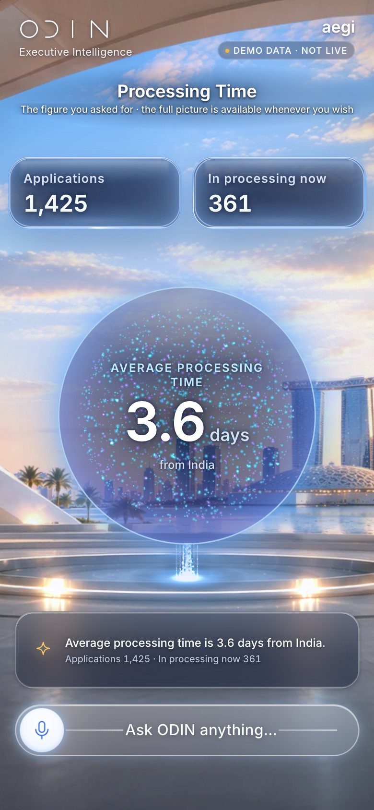

# V23 · Processing Time (focus)

> Average processing time for any filter vs the overall average.

| | |
|---|---|
| Type | Screen |
| Opens with | “Average processing time for India” |
| Feature | F11 |
| Scope status | **Green** · In October scope. |
| Template | `glance` |
| Components | `glance` |
| Effects | [E00](../../03-effects/E00-canvas-layer/SPEC.md) · [E01](../../03-effects/E01-morph/SPEC.md) · [E02](../../03-effects/E02-particles/SPEC.md) · [E03](../../03-effects/E03-globe-aura/SPEC.md) · [E06](../../03-effects/E06-environment/SPEC.md) · [E07](../../03-effects/E07-post-fx/SPEC.md) · [E08](../../03-effects/E08-count-up/SPEC.md) · [E09](../../03-effects/E09-sound/SPEC.md) · [E11](../../03-effects/E11-composer/SPEC.md) |
| Preview (reference app) | `http://localhost:5173/?view=V23` |

**Notes.** Reached by free-text questions with filters.

## Captures

## Files

`component/` holds this screen's own source (same paths as the reference app):

- `src/ui/scene/components/Glance.tsx`
- `src/ui/scene/components/glance.css`
- `src/lib/glance.ts`
- `src/ui/scene/HeroGlass.tsx`
- `src/ui/scene/hero-glass.css`

**Shared** (port once, used by many screens): `src/ui/scene/components/shared.tsx`, `src/ui/scene/SceneIcon.tsx`, `src/ui/bridge.tsx`, `src/lib/format.ts`, `src/lib/homeLayout.ts`, plus the design-system CSS in `02-design-system/source`.

## Data contract

`spec.sample.json` is exactly what this screen renders (DEMO DATA). Types: `05-data-contracts/source/src/odin/types.ts` (`SceneAnswer`). Fields per component:

- `glance` · key `glance`: `item`, `label`, `value`, `format`, `accent`, `caption`, `facts`, `more`, `lights`

## Morph keys

Keep these `data-morph` keys so shared elements travel between screens (E01): `glance`, `ans:processing_time`

## Port it

See `06-port-kit/PORT-PROMPTS.md` → V23. Done = contract test + acceptance test (`ODIN_VIEWS=V23`) pass, motion reviewed.
