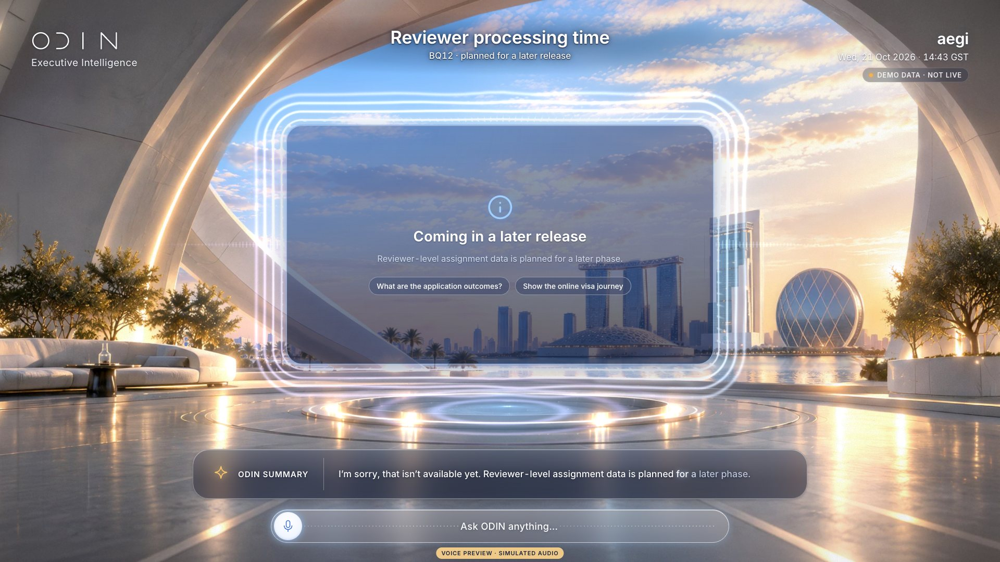
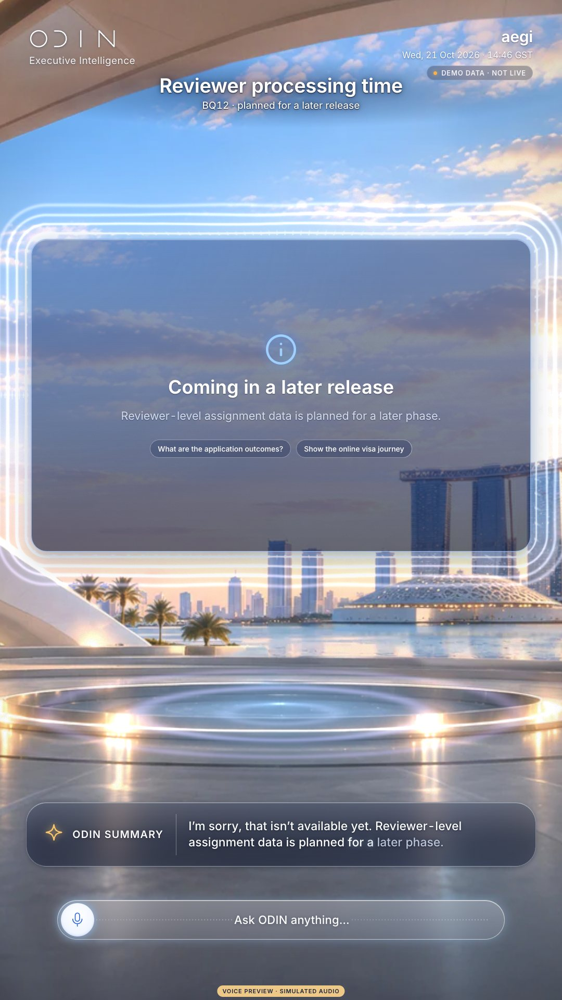
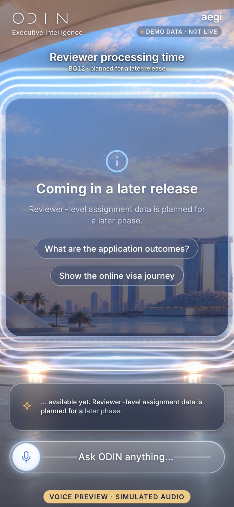

# V24 · Not Available Yet

> Honest notice: why this question cannot be answered yet and what to ask instead.

| | |
|---|---|
| Type | Screen |
| Opens with | “How long do applications remain with individual reviewers?” |
| Business questions | BQ06, BQ12, BQ23, BQ24, BQ25, BQ28, BQ29, BQ30, BQ31 |
| Feature | — |
| Scope status | **Out** · Out of scope: honest “not available” notice. |
| Template | `notice` |
| Components | `notice` |
| Effects | [E00](../../03-effects/E00-canvas-layer/SPEC.md) · [E01](../../03-effects/E01-morph/SPEC.md) · [E02](../../03-effects/E02-particles/SPEC.md) · [E03](../../03-effects/E03-globe-aura/SPEC.md) · [E06](../../03-effects/E06-environment/SPEC.md) · [E07](../../03-effects/E07-post-fx/SPEC.md) · [E08](../../03-effects/E08-count-up/SPEC.md) · [E09](../../03-effects/E09-sound/SPEC.md) · [E11](../../03-effects/E11-composer/SPEC.md) |
| Preview (reference app) | `http://localhost:5173/?view=V24` |

## Captures

## Files

`component/` holds this screen's own source (same paths as the reference app):

- `src/ui/scene/components/Panels.tsx`

**Shared** (port once, used by many screens): `src/ui/scene/components/shared.tsx`, `src/ui/scene/SceneIcon.tsx`, `src/ui/bridge.tsx`, `src/lib/format.ts`, `src/lib/homeLayout.ts`, plus the design-system CSS in `02-design-system/source`.

## Data contract

`spec.sample.json` is exactly what this screen renders (DEMO DATA). Types: `05-data-contracts/source/src/odin/types.ts` (`SceneAnswer`). Fields per component:

- `notice` · key `notice`: `title`, `text`, `suggestions`

## Morph keys

Keep these `data-morph` keys so shared elements travel between screens (E01): `notice`

## Port it

See `06-port-kit/PORT-PROMPTS.md` → V24. Done = contract test + acceptance test (`ODIN_VIEWS=V24`) pass, motion reviewed.
