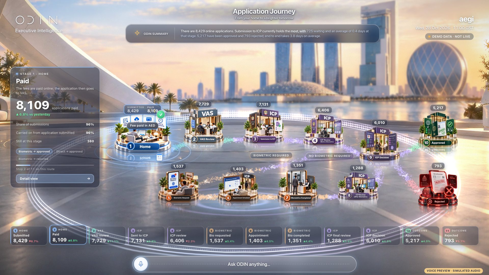
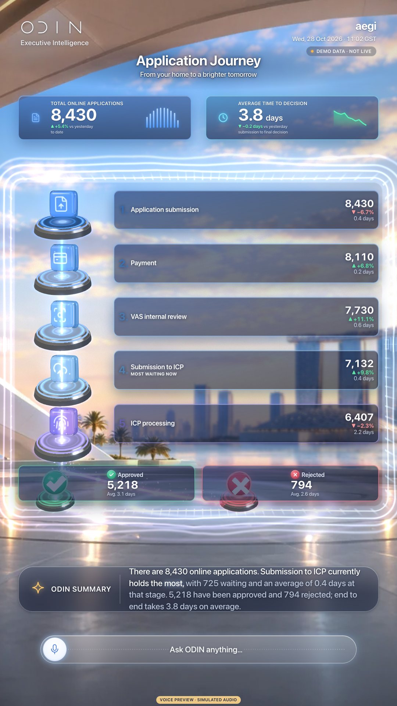
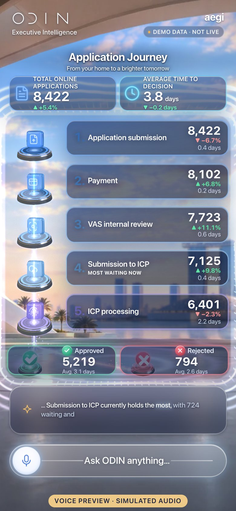

# V39 · Online Visa Journey v4.5

> The application journey as a dashboard (Anupam, 27 Oct): a stage card on the left whose numbers follow the tour, every stage with its live number along the bottom, and the journey in between on equal, subtler units joined by a particle floor at the home sphere's quality. The highlighted stage glows, with rings of light rippling outward on the floor from its base; one application icon travels the route; Home lights the step the applicant is on. "Tell me more" (or the Detail view button) opens the detail view: only the stage the tour is at, larger on the left, morphing from stage to stage, with its dashboard on the right. ODIN speaks only the summary.

| | |
|---|---|
| Type | Screen |
| Opens with | “Show the online visa journey v4.5” |
| Feature | F07a |
| Scope status | **Green** · In October scope. |
| Template | `floor` |
| Components | `metric`, `journey` |
| Effects | [E00](../../03-effects/E00-canvas-layer/SPEC.md) · [E01](../../03-effects/E01-morph/SPEC.md) · [E02](../../03-effects/E02-particles/SPEC.md) · [E03](../../03-effects/E03-globe-aura/SPEC.md) · [E04](../../03-effects/E04-3d-objects/SPEC.md) · [E06](../../03-effects/E06-environment/SPEC.md) · [E07](../../03-effects/E07-post-fx/SPEC.md) · [E08](../../03-effects/E08-count-up/SPEC.md) · [E09](../../03-effects/E09-sound/SPEC.md) · [E11](../../03-effects/E11-composer/SPEC.md) |
| Preview (reference app) | `http://localhost:5173/?view=V39` |

**Notes.** v5.2. The approved application journey (same data, route and tour as V09). Units in public/journey-v42; layout, stage copy and demo detail data in journeyCinema/v42.ts; JourneyCinema42.tsx; particles in FloorParticles.tsx, floor ripples in FloorRings.tsx; styles in journey42.css; voice phrases for the detail view in lib/journeyDetail.ts. Detail breakdowns and insights are demo values until the data team (Jafery, Layth) confirms the fields. Wide screens only; tablet and phone fall back to the vertical journey.

## Captures

## Files

`component/` holds this screen's own source (same paths as the reference app):

- `src/ui/scene/components/Panels.tsx`
- `src/ui/scene/components/Journey.tsx`
- `src/ui/scene/components/journeyGeometry.ts`
- `src/ui/scene/components/JourneyFloor.tsx`
- `src/ui/scene/components/floorJourney.ts`
- `src/ui/scene/components/floor.css`

**Shared** (port once, used by many screens): `src/ui/scene/components/shared.tsx`, `src/ui/scene/SceneIcon.tsx`, `src/ui/bridge.tsx`, `src/lib/format.ts`, `src/lib/homeLayout.ts`, plus the design-system CSS in `02-design-system/source`.

## Data contract

`spec.sample.json` is exactly what this screen renders (DEMO DATA). Types: `05-data-contracts/source/src/odin/types.ts` (`SceneAnswer`). Fields per component:

- `metric` · key `total-online`: `label`, `value`, `format`, `icon`, `accent`, `caption`, `delta`, `spark`
- `metric` · key `e2e-online`: `label`, `value`, `format`, `icon`, `accent`, `caption`, `delta`, `spark`
- `journey` · key `journey`: `channel`, `stages`, `approved`, `rejected`, `emphasisKey`, `floor`, `cinema`

## Morph keys

Keep these `data-morph` keys so shared elements travel between screens (E01): `journey`

## Port it

See `06-port-kit/PORT-PROMPTS.md` → V39. Done = contract test + acceptance test (`ODIN_VIEWS=V39`) pass, motion reviewed.
